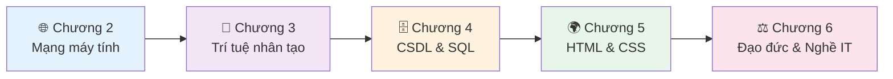
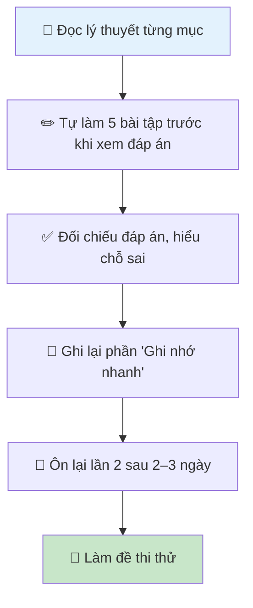

# Giới Thiệu – Bắt Đầu Học

> **Tài liệu ôn thi Tin học THPT – Dành cho học sinh mất gốc**

---

## 👋 Tài liệu này dành cho ai?

Tài liệu này được viết **đặc biệt cho học sinh lớp 12 đang ôn thi tốt nghiệp THPT môn Tin học** – đặc biệt là những bạn cảm thấy:

- 😅 "Mình học Tin học không tốt lắm"
- 😰 "Sách giáo khoa khó hiểu quá"
- 😤 "Không biết thi ra những gì"
- 😨 "Còn ít thời gian mà chưa ôn được gì"

Nếu bạn thuộc một trong những trường hợp trên — **bạn đã đến đúng chỗ rồi.**

---

## 🎯 Tài liệu này khác gì sách giáo khoa?

| Sách giáo khoa | Tài liệu này |
|---|---|
| Định nghĩa khô khan, học thuật | Giải thích bằng ví dụ đời thường dễ hiểu |
| Ít ví dụ thực tế | Mỗi khái niệm có 3 ví dụ: nhà → quán cà phê → trường học |
| Không có bài tập kèm đáp án | Mỗi mục có 5 bài tập, tất cả đều có **đáp án và giải thích chi tiết** |
| Trình bày dàn trải | Có phần **"Ghi nhớ nhanh"** tóm tắt điểm chính để ôn trước khi thi |
| Không chỉ ra lỗi học sinh hay mắc | Có phần **"Lỗi thường gặp"** để tránh mất điểm oan |

---

## 📚 Nội dung ôn thi

Tài liệu bao gồm **5 chương** tương ứng với phần thi tốt nghiệp THPT:

### 🌐 Chương 2 – Mạng Máy Tính & Internet
- **2.1** – Thiết bị mạng: Switch, Router, Modem, Access Point, địa chỉ MAC/IP
- **2.2** – TCP/IP: giao thức TCP, UDP, IPv4, mô hình hoạt động
- **2.3** – LAN & Chia sẻ tài nguyên: mạng nội bộ, chia sẻ file/máy in, quyền truy cập
- **2.4** – Mô hình OSI: 7 tầng, chức năng từng tầng, đơn vị dữ liệu, so sánh với TCP/IP
- **2.5** – Internet & Dịch vụ: WWW, DNS, email (SMTP/POP3/IMAP), FTP, HTTPS
- **2.6** – Bảo mật mạng: Malware, Phishing, DDoS, Firewall, mã hóa, 2FA
- **2.7** – Phân loại mạng: PAN, LAN, MAN, WAN; Topology: Star, Bus, Ring, Mesh
- **2.8** – Ôn tập Chương 2

### 🤖 Chương 3 – Trí Tuệ Nhân Tạo (AI)
- **3.1** – AI là gì: NLP, nhận diện khuôn mặt, hệ gợi ý, AI yếu/mạnh
- **3.2** – Giới hạn của AI: hallucination, common sense, cảm xúc, thiếu sáng tạo
- **3.3** – AI và Giáo dục: lợi ích, nguy cơ, fact-checking, dùng AI đúng cách
- **3.4** – Học máy (Machine Learning): học có/không giám sát, học tăng cường, Deep Learning
- **3.5** – Ứng dụng AI: y tế, giao thông, thương mại điện tử, giải trí, nông nghiệp
- **3.6** – Đạo đức AI: thiên kiến (bias), quyền riêng tư, minh bạch, deepfake
- **3.7** – AI và Xã hội: tác động việc làm, digital divide, echo chamber, quy định pháp lý
- **3.8** – Ôn tập Chương 3

### 🗄️ Chương 4 – Cơ Sở Dữ Liệu & SQL
- **4.1** – CSDL và DBMS: định nghĩa, so sánh với Excel, MySQL/PostgreSQL
- **4.2** – Khóa chính & Khóa ngoại: primary key, composite key, foreign key, toàn vẹn tham chiếu
- **4.3** – SQL cơ bản: SELECT, FROM, WHERE, INNER JOIN, ORDER BY
- **4.4** – DDL: CREATE TABLE, ALTER TABLE, DROP TABLE
- **4.5** – DML: INSERT INTO, UPDATE, DELETE
- **4.6** – SQL nâng cao: COUNT/SUM/AVG/MAX/MIN, GROUP BY, HAVING, LEFT JOIN, DISTINCT, LIMIT
- **4.7** – Ôn tập Chương 4

### 🌍 Chương 5 – HTML & CSS
- **5.1** – HTML cơ bản: DOCTYPE, html/head/body, heading, paragraph, danh sách
- **5.2** – Bảng HTML: table, tr, th, td, colspan, rowspan
- **5.3** – CSS cơ bản: selector, color, font-family, border, cách nhúng CSS
- **5.4** – Liên kết & Hình ảnh: thẻ `<a>`, ``, target, mailto, href neo
- **5.5** – Form HTML: input, textarea, select, button, các kiểu input
- **5.6** – Thẻ ngữ nghĩa: header, nav, main, section, article, footer
- **5.7** – CSS nâng cao: box model, flexbox, responsive, pseudo-class
- **5.8** – Ôn tập Chương 5

### ⚖️ Chương 6 – Đạo Đức & Nghề IT
- **6.1** – Văn hóa mạng: netiquette, cyberbullying và các hình thức
- **6.2** – An toàn thông tin: CIA triad, hacker, virus, phishing, mật khẩu mạnh
- **6.3** – Nghề IT: kỹ sư phần cứng/phần mềm, Data Engineer, UX/UI, quản trị mạng
- **6.4** – Luật An ninh mạng: Luật ANTT Việt Nam 2018, các hành vi bị cấm, xử phạt
- **6.5** – Bản quyền phần mềm: GPL, MIT, freeware, open source, vi phạm bản quyền
- **6.6** – Quyền riêng tư số: dữ liệu cá nhân, cookie, GDPR, quyền bị quên
- **6.7** – Sức khỏe khi dùng máy tính: ergonomics, bức xạ màn hình, nghiện công nghệ
- **6.8** – Tác động CNTT đến xã hội: kinh tế số, thương mại điện tử, cách mạng 4.0
- **6.9** – Ôn tập Chương 6

---

## 🗺️ Lộ Trình Học Gợi Ý

### Nếu còn nhiều thời gian (2–3 tuần)

### Nếu chỉ còn 3–5 ngày

1. **Ngày 1:** Đọc phần "Ghi nhớ nhanh" (🔹 7) của tất cả các mục
2. **Ngày 2:** Làm lại bài tập câu 1 và 2 (dễ) của từng mục
3. **Ngày 3:** Xem lại phần "Lỗi thường gặp" (🔹 9) – đây là điểm dễ mất nhất
4. **Ngày 4:** Làm đề thi thử hoàn chỉnh
5. **Ngày 5:** Xem lại điểm yếu, ôn Ghi nhớ nhanh lần cuối

### Nếu chỉ còn 1 ngày (emergency!)

Ưu tiên theo thứ tự điểm số ước tính:
1. 🗄️ Chương 4 – SQL: kiến thức rất cụ thể, dễ lấy điểm
2. 🌐 Chương 2 – Mạng: nhiều câu hỏi trắc nghiệm rõ ràng
3. 🌍 Chương 5 – HTML/CSS: thực hành, nhớ cú pháp là được
4. ⚖️ Chương 6 – Đạo đức: đọc hiểu, ít cần thuộc lòng
5. 🤖 Chương 3 – AI: khái niệm, cần hiểu chứ không chỉ thuộc

---

## 💡 Cấu Trúc Mỗi Mục Học

Mỗi mục trong tài liệu này được chia thành **9 phần chuẩn**:

| Phần | Tên | Mục đích |
|------|-----|---------|
| 🔹 1 | Giới thiệu siêu cơ bản | Kết nối với đời thực, tạo hứng thú |
| 🔹 2 | Lý thuyết chi tiết | Kiến thức đầy đủ, chính xác để thi |
| 🔹 3 | Giải thích bản chất | Hiểu sâu, không chỉ thuộc lòng |
| 🔹 4 | Luồng hoạt động step-by-step | Thấy rõ cách hoạt động trong thực tế |
| 🔹 5 | Ví dụ minh họa (3 mức độ) | Áp dụng kiến thức vào ví dụ cụ thể |
| 🔹 6 | So sánh & phân biệt | Phân biệt các khái niệm hay nhầm lẫn |
| 🔹 7 | Ghi nhớ nhanh (đi thi) | Tóm tắt điểm mấu chốt để ôn nhanh |
| 🔹 8 | Bài tập tự luyện (5 câu) | Luyện đề, kèm đáp án và giải thích |
| 🔹 9 | Lỗi thường gặp | Tránh các lỗi phổ biến gây mất điểm |

---

## ✅ Checklist Trước Ngày Thi

Trước khi vào phòng thi, hãy đảm bảo bạn đã nắm được:

**Chương 2 – Mạng:**
- [ ] Switch dùng MAC (tầng 2), Router dùng IP (tầng 3)
- [ ] Luồng: Internet → Modem → Router → Switch → Thiết bị
- [ ] TCP = tin cậy, có ACK, 3-way handshake; UDP = nhanh, không ACK
- [ ] IPv4 = 32 bit, 4 octet; dải private: 192.168.x.x
- [ ] OSI có 7 tầng: Physical → Data Link → Network → Transport → Session → Presentation → Application
- [ ] HTTP/HTTPS (web), SMTP (gửi mail), POP3/IMAP (nhận mail), FTP (file), DNS (tên miền→IP)
- [ ] Malware: Virus, Worm, Trojan, Ransomware; Phishing, DDoS, MITM
- [ ] PAN < LAN < MAN < WAN; Topology: Star phổ biến nhất hiện nay

**Chương 3 – AI:**
- [ ] NLP = xử lý ngôn ngữ tự nhiên (chatbot, dịch, phân tích cảm xúc...)
- [ ] Hệ gợi ý hoạt động dựa trên hành vi người dùng
- [ ] Hallucination = AI bịa thông tin tự tin
- [ ] AI hiện tại = AI yếu (narrow AI); AI mạnh (General AI) chưa tồn tại
- [ ] Machine Learning: học có giám sát / không giám sát / tăng cường
- [ ] Deep Learning là tập con của Machine Learning, dùng mạng nơ-ron nhiều tầng
- [ ] AI Bias = thiên kiến do dữ liệu huấn luyện có lỗi
- [ ] Deepfake dùng AI tạo video giả mạo người thật

**Chương 4 – CSDL:**
- [ ] CSDL = nơi lưu dữ liệu; DBMS = phần mềm quản lý (MySQL, PostgreSQL...)
- [ ] Primary Key = UNIQUE + NOT NULL; Composite PK = 2+ cột
- [ ] Foreign Key = tham chiếu đến PK bảng khác
- [ ] SELECT / FROM / WHERE / INNER JOIN / ORDER BY
- [ ] DDL: CREATE TABLE, ALTER TABLE, DROP TABLE
- [ ] DML: INSERT INTO, UPDATE (luôn có WHERE!), DELETE (luôn có WHERE!)
- [ ] COUNT, SUM, AVG, MAX, MIN; GROUP BY + HAVING; LEFT JOIN
- [ ] WHERE lọc hàng (trước GROUP BY); HAVING lọc nhóm (sau GROUP BY)

**Chương 5 – HTML/CSS:**
- [ ] Cấu trúc: DOCTYPE → html → head + body
- [ ] ul = không thứ tự; ol = có thứ tự; li = mục danh sách
- [ ] table → tr → th (tiêu đề) / td (dữ liệu); colspan (gộp cột), rowspan (gộp hàng)
- [ ] CSS: selector { thuộc-tính: giá-trị; }; 3 cách nhúng: Inline, Internal, External
- [ ] `<a href="url">` liên kết; `` hình ảnh
- [ ] Form: `<form>`, `<input type="...">`, `<textarea>`, `<select>`, `<button>`
- [ ] Thẻ ngữ nghĩa: header, nav, main, section, article, footer
- [ ] Box model: content → padding → border → margin

**Chương 6 – Đạo đức:**
- [ ] Netiquette = Network + Etiquette = văn hóa ứng xử trên mạng
- [ ] Cyberbullying: harassment, flaming, outing, exclusion, impersonation, trolling
- [ ] CIA Triad: Confidentiality (bí mật), Integrity (toàn vẹn), Availability (sẵn sàng)
- [ ] White Hat (hợp pháp), Black Hat (bất hợp pháp), Grey Hat (mập mờ)
- [ ] Luật An ninh mạng 2018: quy định hành vi trên mạng, xử phạt vi phạm
- [ ] Open source ≠ miễn phí; GPL, MIT là giấy phép phần mềm tự do phổ biến
- [ ] Dữ liệu cá nhân: họ tên, CCCD, email, số điện thoại, vị trí địa lý...
- [ ] Ergonomics: tư thế ngồi đúng, khoảng cách màn hình 50–70 cm, nghỉ mắt 20-20-20

---

## 🚀 Bắt Đầu Ngay

👉 [**Vào học Chương 2.1 – Thiết bị mạng**](/chuong-2/2.1-thiet-bi-mang)

---

*Chúc bạn ôn thi hiệu quả và đạt kết quả tốt nhất! 🎓*
